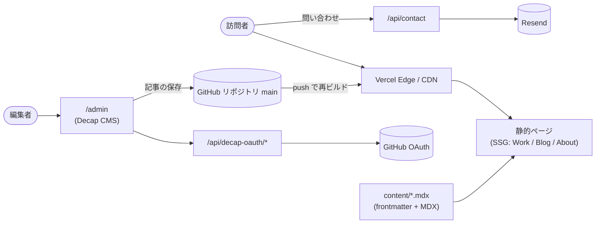

# naokikaneko.com

個人用ポートフォリオ・名刺サイト。プロフィール / 実績（Work） / 技術ブログ（Blog） / お問い合わせを1つのサイトに集約。

- **公開URL**: https://naokikaneko.com
- **リポジトリ**: https://github.com/nokgc333/naokikaneko

## 概要

Next.js（App Router）+ TypeScript + Tailwind CSSで構築したフルスクラッチのポートフォリオサイト。
コンテンツはMarkdown/MDXで管理し、Decap CMSによるノーコード編集とGitベースの手動運用の両方に対応している。
単なる静的な自己紹介ページではなく、実務を想定した設計判断・テスト・CI/CDまで一通り実装した。

## 主な機能

| 機能 | 概要 |
|---|---|
| Work（実績）一覧・詳細 | カテゴリ絞り込み、MDXによる本文レンダリング |
| Blog（技術記事）一覧・詳細 | グリッド/リスト表示切替、新しい順・古い順の並び替え、見出し目次（TOC）、関連記事サイドバー |
| お問い合わせフォーム | React Hook Form + Zodバリデーション、Resend経由のメール送信（独自ドメインでDKIM/SPF/DMARC認証済み） |
| コンテンツ管理 | Decap CMS（`/admin`からのWeb編集）と、Gitへの直接コミットの両方でMarkdown/MDXコンテンツを追加可能。手順と書式は `CONTENT_GUIDE.md`、検査は `npm run content:check` |
| SEO | 動的サイトマップ・robots.txt、Open Graph / Twitter Card対応 |

## 技術スタック

| 分類 | 技術 |
|---|---|
| フレームワーク | Next.js 16（App Router / Turbopack） |
| 言語 | TypeScript |
| スタイリング | Tailwind CSS v4, shadcn/ui |
| コンテンツ | Markdown / MDX（`next-mdx-remote`, `remark`/`rehype`系プラグイン）, Decap CMS |
| バリデーション | Zod |
| フォーム | React Hook Form |
| メール送信 | Resend |
| テスト | Vitest（単体・結合）, Playwright（E2E） |
| CI | GitHub Actions（Lint / 型チェック / テスト / E2E） |
| ホスティング | Vercel |

## 設計・実装上のポイント

- **レンダリング方式の統一**: 

Work・Blog双方の詳細ページを`MDXRemote`ベースに統一し、コンテンツ種別によるレンダリングロジックの分岐をなくした。

- **コンテナクエリによるレスポンシブ画像**:

サムネイルの`object-fit`を、ビューポート幅ではなくカード自身の実測アスペクト比に応じて切り替え、多カラムレイアウトでも崩れないようにした。

- **フォールバック込みのフォント設計**:

Google Fonts（Roboto / Noto Sans JP）にOSフォントの完全なフォールバックスタックを付与し、フォント読み込み前後でのレイアウトシフトを抑制している。

- **Zodによるフロントマター検証**:

Markdown/MDXのfrontmatterをZodスキーマでパースし、不正なコンテンツをビルド時に検知できるようにした。

- **アクセシビリティへの配慮**:

アイコンのみのUIには`aria-label`を付与し、視覚的な省略とスクリーンリーダー向けの情報を両立している。

## アーキテクチャ



- ページは、ビルド時に `content/` の MDX から静的に生成される。実行時に動くサーバー処理は、お問い合わせと CMS のログインの 3 つの API ルートだけ。
- 記事を保存すると `main` にコミットされ、Vercel が再ビルドして公開する。

### `src/lib/` の構成

| フォルダ | 責務 |
|---|---|
| `content/` | 記事の読み込みと検証（`index.ts`、`schema.ts`）、目次（`toc.ts`）、カテゴリと絞り込み、コンテンツ検査（`check.ts`） |
| `contact/` | お問い合わせの処理: 入力スキーマ、メール組み立て（純関数）、ハンドラ、API の型（クライアントとサーバーで共有） |
| `security/` | レート制限、クライアント IP、本文サイズの上限、セキュリティヘッダ、定数時間比較 |
| `seo/` | ページのメタデータ、構造化データ（JSON-LD）、共有用の OG 画像、サイトの URL |
| `env.ts` | 環境変数のスキーマと検証（不足・不正は変数名だけを報告し、値は出さない） |

ルート（`src/app/api/*`）は薄く、ロジックは `lib/` の関数に置く。`/api/contact` のルートは 5 行。

## スクリプト一覧

| コマンド | 内容 |
|---|---|
| `npm run dev` | 開発サーバー（`http://localhost:3000`） |
| `npm run build` / `npm run start` | 本番ビルド / 本番サーバー |
| `npm run lint` | ESLint（複雑度 10 以下、関数 80 行以下を含む） |
| `npm run type-check` | 型検査（`tsc --noEmit`） |
| `npm run format` / `npm run format:check` | Prettier での整形 / 検査 |
| `npm run test` / `npm run test:watch` | 単体・結合テスト（Vitest） |
| `npm run test:coverage` | カバレッジ付き（Stmts / Branch / Funcs / Lines が 95% 未満なら失敗） |
| `npm run test:e2e` | E2E（Playwright、アクセシビリティの axe 検査を含む） |
| `npm run test:perf` | 性能予算（Lighthouse CI） |
| `npm run content:check` | 記事の frontmatter・slug・日付・画像の検査 |
| `npm run secrets:check` | 秘密情報の検出（secretlint） |
| `npm run prepare` | git フック（husky）の有効化。`npm install` / `npm ci` で自動実行される |
| `npm run cms:proxy` | ローカルの CMS サーバー（ログイン不要で `content/` を編集） |

## セキュリティ方針

- **入力**: お問い合わせは `zod` で検証し、制御文字（件名への注入）・長さ・本文サイズ（16KB）を制限する。honeypot とレート制限（IP ごと）で連投を防ぐ。
- **出力**: 記事の HTML は `rehype-sanitize` で取り除く。JSON-LD は `<` `>` `&` をエスケープする。
- **ヘッダ**: CSP・HSTS（`includeSubDomains` なし）・`X-Frame-Options`・`X-Content-Type-Options`・`Referrer-Policy`・`Permissions-Policy`。`X-Powered-By` は出さない。CSP の `script-src` に `'unsafe-inline'` が残る理由は ADR-0005。
- **CMS のログイン**: スコープは `public_repo` のみ。`state` は定数時間で比較し、認可とコールバックにレート制限。トークンはログに出さない（ADR-0002）。
- **依存と秘密情報**: CI で `npm audit`（high 以上で失敗）、Dependency Review、CodeQL を実行し、毎週も実行する。GitHub のシークレットスキャンとプッシュ保護が有効。秘密情報はコミットしない（`.env*` は `.gitignore`）。

## 性能

Lighthouse（モバイル、模擬回線、本番ビルドをローカルで計測、2026-10-25）。

| ページ | 性能 | LCP | 備考 |
|---|---|---|---|
| トップ | 0.96〜0.97 | 2.6〜2.7s | 未使用 JS 29KiB、総転送約 350KB |
| ブログ一覧 | 0.91 | 3.2s | |
| Work 詳細 | 0.8 | 4.4s | 日本語フォントで総転送が約 0.6MB |
| ブログ記事 | 0.81〜0.85 | 3.8〜4.1s | 日本語フォントで総転送が約 1.2MB |

アクセシビリティ・ベストプラクティス・SEO は、主要 5 ページのモバイル・デスクトップの両方で 100。予算と、改善の経緯・採用しなかった案は ADR-0006。

## デプロイ

1. Vercel で GitHub のリポジトリを接続する（フレームワークは Next.js が自動で検出される）。
2. 環境変数を Production と Preview に登録する（「セットアップ」の表）。
3. 独自ドメインを設定し、Resend 側で同じドメインを認証する。
4. `develop` で作業し、`main` への PR を作る。CI（Lint・型・テスト・E2E・性能予算・セキュリティ）がすべて通ったら、マージコミットで取り込む。`main` への反映で、本番に自動でデプロイされる。
5. PR ごとに Vercel のプレビューが作られる。

## 開発の進め方（自動化とブランチ保護）

- **コミット前の検査**: `npm ci` で husky が有効になり、コミット時にステージ済みのファイルだけを検査する（ESLint・Prettier・秘密情報の検出 `secretlint`）。全体の秘密情報の検査は `npm run secrets:check`。
- **依存の自動更新**: Dependabot が毎週月曜に、npm と GitHub Actions の更新 PR を作る（`.github/dependabot.yml`）。CI が通ってからマージする。
- **ブランチ保護**: `main` は、必須チェックの通過と、force push・削除の禁止。管理者は対象外にしてあり、CMS の保存（`main` への直接コミット）を妨げない。方針は ADR-0008。リポジトリの管理者が、次のコマンドで適用する。

```bash
gh api -X PUT repos/<owner>/<repo>/branches/main/protection --input .github/branch-protection/main.json
gh api -X PUT repos/<owner>/<repo>/branches/develop/protection --input .github/branch-protection/develop.json
gh api -X PUT repos/<owner>/<repo>/automated-security-fixes
```

3 行目は、Dependabot のセキュリティ更新（脆弱性の修正 PR）を有効にする。

## 設計記録（ADR）

判断の理由と、見直す条件は `docs/adr/` にある。

| ADR | 内容 |
|---|---|
| [0001](docs/adr/0001-mdx-content-pipeline.md) | コンテンツは MDX + `next-mdx-remote`（RSC）で描画する |
| [0002](docs/adr/0002-decap-cms-with-own-github-oauth.md) | Decap CMS と、自前の GitHub OAuth ルート |
| [0003](docs/adr/0003-in-memory-rate-limiting.md) | レート制限は、プロセス内メモリの固定窓 |
| [0004](docs/adr/0004-react-compiler.md) | React Compiler を有効のままにする（計測あり） |
| [0005](docs/adr/0005-keep-unsafe-inline-script-src.md) | CSP の `script-src` に `'unsafe-inline'` を残す（計測あり） |
| [0006](docs/adr/0006-performance-budgets-and-fonts.md) | 性能予算と、日本語フォントの扱い |
| [0007](docs/adr/0007-license-split.md) | コードは MIT、コンテンツは権利留保 |
| [0008](docs/adr/0008-automation-and-branch-protection.md) | 依存の自動更新・pre-commit・ブランチ保護の方針 |

## テスト・品質管理

- 単体・結合テスト（Vitest、カバレッジ 95% 以上を CI で強制）、E2E（Playwright、axe によるアクセシビリティ検査）、性能予算（Lighthouse CI）、コンテンツ検査（`content:check`）。コマンドは「スクリプト一覧」。
- GitHub Actions で Pull Request ごとに、Lint・整形・コンテンツ検査・型検査・単体テスト・E2E・性能予算（`.github/workflows/ci.yml`）と、依存の監査・Dependency Review・CodeQL（`.github/workflows/security.yml`）を実行する。Node のバージョンは `.nvmrc` から読む。

## セットアップ

### 前提

- Node.js 24.15 以上（`.nvmrc` は `24`。`nvm install 24 && nvm use` で最新の 24 系にする。jsdom 30 の要求）。別の版では `npm install` が失敗する（`engine-strict`）。
- npm 11 以上。

### 起動

```bash
nvm use
npm ci
cp .env.example .env.local   # 値は次の節を見て埋める
npm run dev                  # http://localhost:3000
```

環境変数が空でも、サイトの閲覧は動く。お問い合わせの送信と CMS のログインだけが、それぞれの設定を必要とする（未設定の機能は 500 を返し、ログに不足している変数名が出る）。

### 環境変数

| 変数 | 必要な機能 | 値 | Vercel での種別 |
|---|---|---|---|
| `RESEND_API_KEY` | お問い合わせ | Resend の API キー | シークレット（Sensitive） |
| `ADMIN_EMAIL` | お問い合わせ | 問い合わせの届け先（自分のメール） | 通常 |
| `CONTACT_MAIL_FROM` | お問い合わせ | 送信元。`名前 <address@your-domain>` の形。ドメインは Resend で認証済みであること | 通常 |
| `GITHUB_OAUTH_CLIENT_ID` | CMS のログイン | GitHub OAuth App の Client ID | 通常 |
| `GITHUB_OAUTH_CLIENT_SECRET` | CMS のログイン | GitHub OAuth App の Client Secret | シークレット（Sensitive） |

- 本番（Vercel）では、同じ名前を Project Settings > Environment Variables に登録する。Production と Preview の両方に設定する。
- 値はコミットしない（`.env*` は `.gitignore` 済みで、`.env.example` だけが追跡される）。
- 値が不正（形式が違う）な場合も、不足と同じく該当機能が 500 を返し、ログに変数名だけが出る（値は出ない）。

### 外部サービスの設定

**Resend（お問い合わせのメール送信）**

1. Resend でドメインを追加し、DNS に DKIM / SPF / DMARC のレコードを登録して認証する。
2. API キーを発行し、`RESEND_API_KEY` に設定する。
3. `CONTACT_MAIL_FROM` に、認証済みドメインの送信元アドレスを設定する。

**GitHub OAuth App（CMS のログイン）**

1. GitHub > Settings > Developer settings > OAuth Apps で、新しい OAuth App を作る。
2. Homepage URL にサイトの URL、Authorization callback URL に `<サイトの URL>/api/decap-oauth/callback` を設定する。
3. Client ID と、発行した Client Secret を、`GITHUB_OAUTH_CLIENT_ID` / `GITHUB_OAUTH_CLIENT_SECRET` に設定する。
4. 要求するスコープは `public_repo` のみ（公開リポジトリへの書き込み）。

**Decap CMS**

- 設定は `public/admin/config.yml`。`backend.repo` / `branch` / `base_url` / `auth_endpoint` を自分のリポジトリとサイトに合わせる。
- 本番: `<サイトの URL>/admin/index.html` を開き、GitHub でログインする。記事を保存すると、`main` に直接コミットされる。
- ローカル（ログイン不要）: 別のターミナルで `npm run cms:proxy` を起動し、`http://localhost:3000/admin/index.html` を開く（`local_backend: true`）。ローカルの `content/` を直接編集する。

## ライセンス

- ソースコードは MIT License（`LICENSE`）。
- `content/`（記事）、`public/images/uploads/`（画像）、About ページのプロフィール文は対象外で、すべての権利を留保する（`CONTENT_LICENSE.md`）。

## ディレクトリ構成

```
src/
  app/            # App Router（ページ・APIルート）
  components/     # UIコンポーネント
  hooks/          # クライアントのフック
  lib/            # ロジック（content / contact / security / seo、env.ts）
  project/        # リポジトリの設定・文書を検査するテスト
content/
  work/           # Work記事（.mdx）
  blog/           # Blog記事（.mdx）
public/admin/     # Decap CMS設定
e2e/              # Playwright E2Eテスト
scripts/          # content:check
docs/adr/         # 設計記録
```
