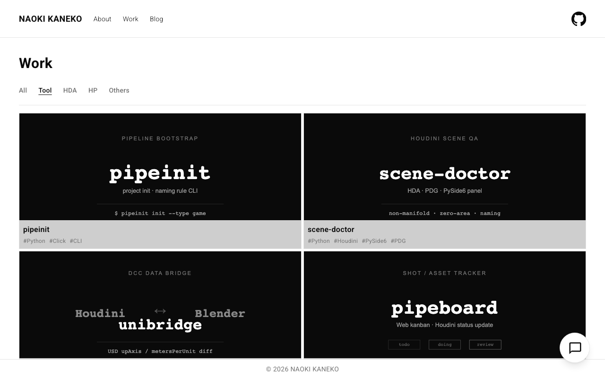
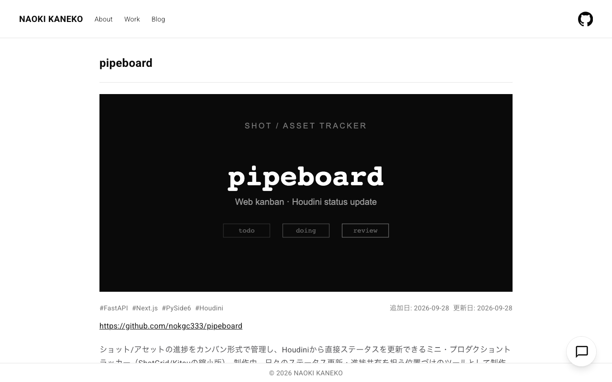
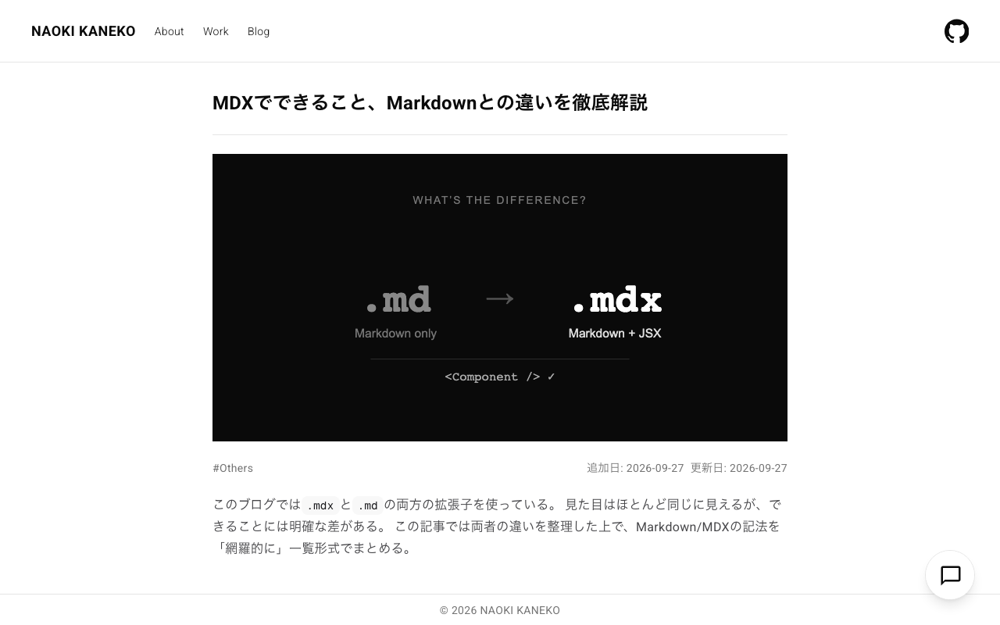
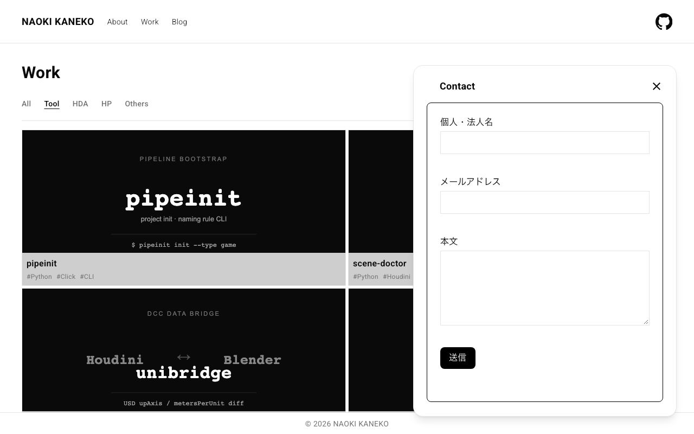

# naokikaneko.com

[](https://github.com/nokgc333/naokikaneko/actions/workflows/ci.yml)

個人用ポートフォリオ・名刺サイト。プロフィール / 実績（Work） / 技術ブログ（Blog） / お問い合わせを1つのサイトに集約。

- **公開URL**: https://naokikaneko.com
- **リポジトリ**: https://github.com/nokgc333/naokikaneko

## 概要

Next.js（App Router）+ TypeScript + Tailwind CSSで構築したフルスクラッチのポートフォリオサイト。
コンテンツはMarkdown/MDXで管理し、Decap CMSによるノーコード編集とGitベースの手動運用の両方に対応している。
単なる静的な自己紹介ページではなく、実務を想定した設計判断・テスト・CI/CDまで一通り実装した。

## 画面

- **Work 一覧(トップ):** カテゴリで絞り込める。右下の吹き出しから、どのページでも問い合わせができる。

  

- **Work の詳細:** MDX の本文と、使った技術のタグ。

  

- **Blog の記事:** 見出しの目次・関連記事は、広い画面で本文の両側に出る。

  

- **お問い合わせ:** 全ページ共通のパネル。入力は Zod で検証し、Resend で送る。

  

画像は、本番(2026-11-08)の画面。

## 主な機能

- **Work（実績）一覧・詳細:** カテゴリ絞り込み、MDXによる本文レンダリング
- **Blog（技術記事）一覧・詳細:** グリッド/リスト表示切替、新しい順・古い順の並び替え、見出し目次（TOC）、関連記事サイドバー
- **お問い合わせフォーム:** React Hook Form + Zodバリデーション、Resend経由のメール送信（独自ドメインでDKIM/SPF/DMARC認証済み）
- **コンテンツ管理:** Decap CMS（`/admin`からのWeb編集）と、Gitへの直接コミットの両方でMarkdown/MDXコンテンツを追加可能。手順と書式は `CONTENT_GUIDE.md`、検査は `npm run content:check`
- **SEO:** 動的サイトマップ・robots.txt、Open Graph / Twitter Card対応

## 技術スタック

- **フレームワーク:** Next.js 16（App Router / Turbopack）
- **言語:** TypeScript
- **スタイリング:** Tailwind CSS v4, shadcn/ui
- **コンテンツ:** Markdown / MDX（`next-mdx-remote`, `remark`/`rehype`系プラグイン）, Decap CMS
- **バリデーション:** Zod
- **フォーム:** React Hook Form
- **メール送信:** Resend
- **テスト:** Vitest（単体・結合）, Playwright（E2E）
- **CI:** GitHub Actions（Lint / 型チェック / テスト / E2E）
- **ホスティング:** Vercel

## 設計・実装上のポイント

- **レンダリング方式の統一**: 

Work・Blog双方の詳細ページを`MDXRemote`ベースに統一し、コンテンツ種別によるレンダリングロジックの分岐をなくした。

- **コンテナクエリによるレスポンシブ画像**:

サムネイルの`object-fit`を、ビューポート幅ではなくカード自身の実測アスペクト比に応じて切り替え、多カラムレイアウトでも崩れないようにした。

- **フォールバック込みのフォント設計**:

Google Fonts（Roboto / Noto Sans JP）にOSフォントの完全なフォールバックスタックを付与し、フォント読み込み前後でのレイアウトシフトを抑制している。

- **Zodによるフロントマター検証**:

Markdown/MDXのfrontmatterをZodスキーマでパースし、不正なコンテンツをビルド時に検知できるようにした。

- **アクセシビリティへの配慮**:

アイコンのみのUIには`aria-label`を付与し、視覚的な省略とスクリーンリーダー向けの情報を両立している。

## スクリプト一覧

- **`npm run dev`:** 開発サーバー（`http://localhost:3000`）
- **`npm run build` / `npm run start`:** 本番ビルド / 本番サーバー
- **`npm run lint`:** ESLint（複雑度 10 以下、関数 80 行以下を含む）
- **`npm run type-check`:** 型検査（`tsc --noEmit`）
- **`npm run format` / `npm run format:check`:** Prettier での整形 / 検査
- **`npm run test` / `npm run test:watch`:** 単体・結合テスト（Vitest）
- **`npm run test:coverage`:** カバレッジ付き（Stmts / Branch / Funcs / Lines が 95% 未満なら失敗）
- **`npm run test:e2e`:** E2E（Playwright、アクセシビリティの axe 検査を含む）
- **`npm run test:perf`:** 性能予算（Lighthouse CI）
- **`npm run content:check`:** 記事の frontmatter・slug・日付・画像の検査
- **`npm run secrets:check`:** 秘密情報の検出（secretlint）
- **`npm run prepare`:** git フック（husky）の有効化。`npm install` / `npm ci` で自動実行される
- **`npm run cms:proxy`:** ローカルの CMS サーバー（ログイン不要で `content/` を編集）

## Requirements

- Node.js 24 (see `.nvmrc`), minimum version in `package.json`.
- npm 11 以上。
- Install dependencies with `npm ci`.


## 開発の進め方（自動化とブランチ保護）

- **コミット前の検査**: `npm ci` で husky が有効になり、コミット時にステージ済みのファイルだけを検査する（ESLint・Prettier・秘密情報の検出 `secretlint`）。全体の秘密情報の検査は `npm run secrets:check`。
- **依存の自動更新**: Dependabot が毎週月曜に、npm と GitHub Actions の更新 PR を作る（`.github/dependabot.yml`）。CI が通ってからマージする。
- **ブランチ保護**: `main` は、必須チェックの通過と、force push・削除の禁止。管理者は対象外にしてあり、CMS の保存（`main` への直接コミット）を妨げない。方針は ADR-0008。リポジトリの管理者が、次のコマンドで適用する。

```bash
gh api -X PUT repos/<owner>/<repo>/branches/main/protection --input .github/branch-protection/main.json
gh api -X PUT repos/<owner>/<repo>/automated-security-fixes
```

3 行目は、Dependabot のセキュリティ更新（脆弱性の修正 PR）を有効にする。

## Content editing

See [CONTENT_GUIDE.md](CONTENT_GUIDE.md) for frontmatter, categories, manual editing and browser editing.

- `npm run content:check`: validate entries before saving.
- `npm run cms:proxy`: run the local CMS server, then open `http://localhost:3000/admin` alongside the development server.
- `npm run prepare`: enable the staged-file hook; npm ci runs this automatically.


## Setup

Use the Node version from `.nvmrc`, run `npm ci`, copy the empty `.env.example` template to `.env.local`, and set only the variables needed by the feature. Never commit their values.

- `RESEND_API_KEY`: Resend API key for contact mail.
- `ADMIN_EMAIL`: destination address for contact mail.
- `CONTACT_MAIL_FROM`: sender address on a domain verified by Resend.
- `GITHUB_OAUTH_CLIENT_ID`: GitHub OAuth App client ID for CMS login.
- `GITHUB_OAUTH_CLIENT_SECRET`: GitHub OAuth App client secret for CMS login.

Register the same names in the hosting environment for Production and Preview. Without settings, browsing works; mail and CMS login return a configuration error.

Verify the sending domain in Resend with its DNS records. Create a GitHub OAuth App with the site as Homepage URL and `<site URL>/api/decap-oauth/callback` as Authorization callback URL. The requested scope is public_repo.

CMS settings live in `public/admin/config.yml`: set the repository, branch, base URL and authorization endpoint for the target site. Open `/admin` and log in with GitHub to save content directly to main. For local editing, run `npm run cms:proxy`; local_backend enables editing without login.


## Design records

- [0001](docs/adr/0001-mdx-content-pipeline.md)
- [0002](docs/adr/0002-decap-cms-with-own-github-oauth.md)
- [0003](docs/adr/0003-in-memory-rate-limiting.md)
- [0004](docs/adr/0004-react-compiler.md)
- [0005](docs/adr/0005-keep-unsafe-inline-script-src.md)
- [0007](docs/adr/0007-license-split.md)
- [0008](docs/adr/0008-automation-and-branch-protection.md)

## ライセンス

- ソースコードは MIT License（`LICENSE`）。
- `content/`（記事）、`public/images/uploads/`（画像）、About ページのプロフィール文は対象外で、すべての権利を留保する（`CONTENT_LICENSE.md`）。

